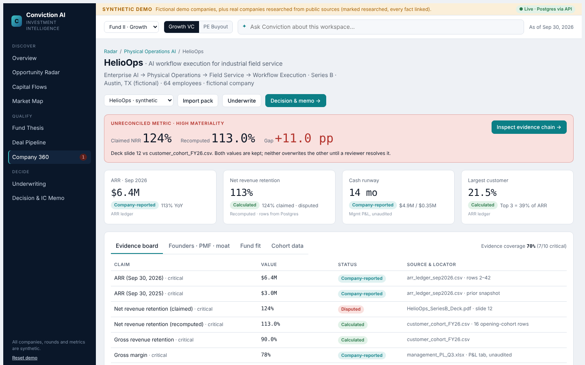
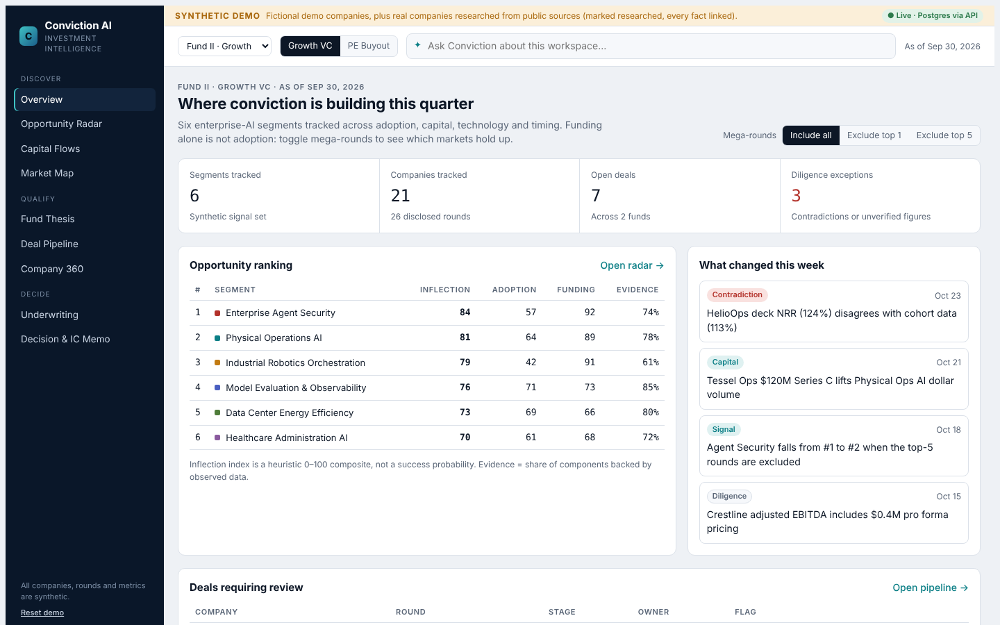
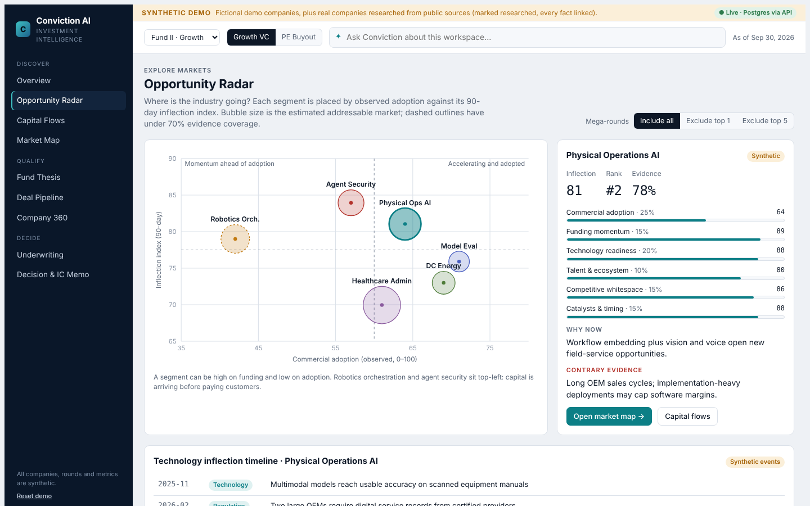
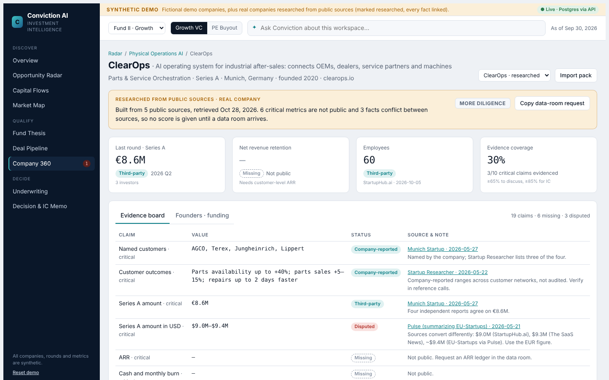
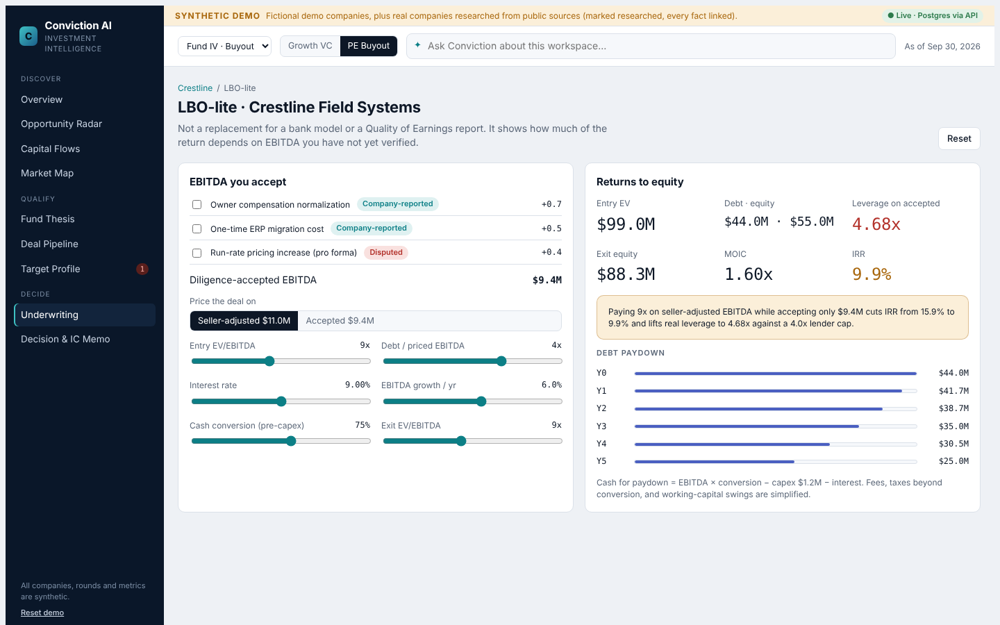
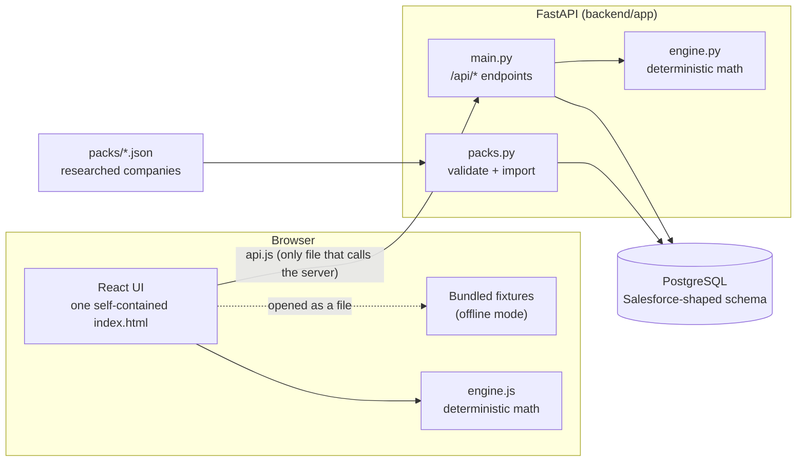

# Conviction AI

**From identifying market opportunities to evidence-backed investment decisions.**

Conviction AI is an investment-intelligence workspace for venture capital and private equity teams. It follows one deal from "which market is inflecting?" to "should we take this to investment committee?", and at every step it shows where each number came from. When a company's pitch deck says one thing and its own data says another, the app keeps both values side by side, recomputes the metric from source rows, drafts the question for the CFO and holds the deal back from IC until a person resolves it.



> **Demo data.** HelioOps, Crestline and every other demo company, fund, round and metric are **fictional**. The one exception is **ClearOps**, a real company researched from public sources: every ClearOps fact links to the page it came from, and anything not public is shown as *Missing*. Nothing here is investment advice, and no paid data provider is connected.

## Contents

- [Why this exists](#why-this-exists)
- [Try it in 2 minutes](#try-it-in-2-minutes)
- [Three ways to run it](#three-ways-to-run-it)
- [Using the UI: the 5-minute walkthrough](#using-the-ui-the-5-minute-walkthrough)
- [The demo companies](#the-demo-companies)
- [How it works](#how-it-works)
- [Data model](#data-model)
- [Real companies: company packs](#real-companies-company-packs)
- [Full setup](#full-setup)
- [Configuration reference](#configuration-reference)
- [HTTP API](#http-api)
- [Testing](#testing)
- [Project layout](#project-layout)
- [Security and data handling](#security-and-data-handling)
- [Troubleshooting](#troubleshooting)
- [FAQ and limitations](#faq-and-limitations)
- [Roadmap](#roadmap)
- [License](#license)

## Why this exists

Capital is concentrating in AI faster than investment teams can check the stories that attract it.

- **82.7%** of US venture deal value in the first nine months of 2026 went to AI companies ([PitchBook-NVCA Venture Monitor, Q3 2026, via SiliconANGLE](https://siliconangle.com/?p=849755)). When most of the money chases one theme, the hard question stops being "is AI growing?" and becomes "which sub-segment is actually being adopted, and is this company's traction real?"
- The share of PE and VC firms using AI to make investment decisions roughly doubled in a year, **from 13% to 28%**, and **57%** of investors spend 21 or more hours a week on deal research ([Affinity 2026 private capital predictions, 275 investors](https://affinity.co/blog/2026-private-capital-predictions)).

Most AI tools for investors make research faster: summarise the deck, draft the memo. Faster isn't the problem. A deck that claims 124% net revenue retention will produce a confident memo that says 124%. The expensive mistakes come from metrics that were never checked, private numbers that were guessed, and conflicting sources where one quietly overwrote the other.

Conviction AI is built around the opposite job: **make the evidence visible and make the gaps impossible to miss.**

| Principle | What it means in the product |
| --- | --- |
| The model never does the math | Every figure (NRR, GRR, runway, TAM, MOIC, IRR, the inflection index, LBO returns) comes from a tested, deterministic engine in [`backend/app/engine.py`](backend/app/engine.py) and its twin [`web/src/engine.js`](web/src/engine.js). Language is for explaining, not calculating. |
| Conflicts are kept, never overwritten | When two sources disagree, both values stay in `evidence_claim__c` with status *Disputed*. A reviewer records a resolution; the original value is still kept. |
| Unknown is shown as unknown | A missing metric shows as *Missing*. It never counts as a pass or gets a default score. |
| Coverage is separate from score | A company can score well and still be blocked because only 3 of 10 critical claims are evidenced. |
| Humans own decisions | Every pipeline stage change is a person's action, recorded in `opportunity_field_history` with who and when. |
| CRM-shaped from day one | The database mirrors Salesforce objects, so a firm already on Salesforce could sync it field for field. |

## Try it in 2 minutes

You only need a browser. The UI is one self-contained HTML file with the demo data bundled in.

**Option A: get just this folder with git**

```bash
git clone --filter=blob:none --sparse https://github.com/hithakishore-all/ai-product-leadership-portfolio.git
cd ai-product-leadership-portfolio
git sparse-checkout set ConvictionAI
cd ConvictionAI
open web/dist/index.html        # Mac. On Windows: start web\dist\index.html
```

**Option B: no git**

On the repository page, choose **Code → Download ZIP**, unzip it, open the `ConvictionAI` folder and double-click `web/dist/index.html`.

That's the **offline demo**: every screen works, and your changes (deal moves, resolutions, uploaded cohort CSVs) are saved in your browser. To run it on a real database instead, see [Full setup](#full-setup); it takes about ten minutes.

| | |
| --- | --- |
|  |  |
| **Overview**: what changed this week across markets, deals and evidence | **Opportunity Radar**: segments ranked by an inflection index, with or without the mega-rounds |
|  |  |
| **Researched company**: ClearOps built only from public sources, gaps marked *Missing* | **PE mode**: LBO-lite showing how much of the return rests on unverified EBITDA |

## Three ways to run it

| Mode | What you need | What you get | Start with |
| --- | --- | --- | --- |
| **Offline demo** | A browser | All screens, bundled demo data, changes saved in your browser | `open web/dist/index.html` |
| **Full stack (live)** | Postgres, Python 3.9+, Node 18+ | UI served by FastAPI, every read and write goes to Postgres, cohort CSV upload, company-pack import, audit trail, API docs at `/docs` | `make doctor` → `make setup` → `make db` → `make run` |
| **Developer** | Same as full stack | Edit `web/src`, rebuild the single HTML file, run 32 automated tests | `make build`, `make test` |

The UI decides its mode by itself. Served by the API at `http://localhost:8000`, the top-right badge reads **● Live · Postgres via API**. Opened as a file, it reads **Offline**. The screens and the design are identical in both.

## Using the UI: the 5-minute walkthrough

The left navigation follows the investment workflow: **Discover → Qualify → Decide**. The top bar switches funds and between **Growth VC** and **PE Buyout** mode, and holds an *Ask Conviction* box that answers questions about the workspace with citations.

1. **Overview.** The change feed: which segment moved, which deal changed stage, which claim is disputed.
2. **Opportunity Radar.** Six AI sub-segments scored on an inflection index (adoption 25%, technology 20%, funding 15%, white space 15%, catalysts 15%, talent 10%). Under **Mega-rounds**, choose **Exclude top 1** or **Exclude top 5**. With the five largest rounds removed, Physical Operations AI overtakes Enterprise Agent Security for #1: a lot of the "momentum" was a few giant rounds.
3. **Capital Flows** and **Market Map.** Which investors are writing checks where, and the companies in each segment.
4. **Fund Thesis.** The fund's mandate as rules: sectors, stages, check size, minimum growth, minimum NRR, maximum customer concentration, minimum runway. Edit them and every deal re-scores.
5. **Deal Pipeline.** Opportunities by stage. Moving a card is saved to Postgres with an audit record ([screenshot](docs/screenshots/04-deal-pipeline.png)).
6. **Company 360 → HelioOps.** Click **Load synthetic HelioOps data room**. Sixteen customer rows load from `customer_arr__c` and the engine recomputes NRR at **113.0%** against the deck's **124%**. The red banner holds both values and the +11.0 pp gap. **Inspect evidence chain** shows the formula and the rows. On the **Cohort data** tab you can upload your own CSV (`customer,opening_arr,ending_arr`) and watch it recompute.
7. **Underwriting.** Bottom-up TAM/SAM/SOM and VC exit scenarios (MOIC and IRR) from editable assumptions.
8. **Decision & IC Memo.** The recommendation is rule-based: *More diligence* below 65% evidence coverage, *Advance with conditions* while blockers remain or coverage is below 85%, *Advance to IC* only when both clear. Click **Make the bear case**, then **Prepare IC memo** for a sourced draft ([bear case](docs/screenshots/05-decision-bear-case.png) · [memo](docs/screenshots/06-ic-memo.png)).
9. **PE mode.** Switch to **PE Buyout**. Crestline Field Systems replaces HelioOps; the question becomes "can we buy durable cash flow at a price that returns capital?" In **LBO-lite**, tick which EBITDA adjustments you accept: pricing the deal on seller-adjusted EBITDA while accepting only $9.4M cuts IRR from 15.9% to 9.9% and pushes leverage to 4.68x against a 4.0x cap.
10. **Researched company.** In Company 360, choose **ClearOps · researched** from the company picker (live mode). Everything shown came from five public sources; six critical metrics are *Missing* and three facts are *Disputed*, so coverage is 30% and the recommendation is *More diligence*. **Copy data-room request** lists exactly what to ask the company for.

**Reset demo** (bottom left) puts everything back. In live mode it reseeds Postgres.

A longer, timed presenter script is in [docs/DEMO_SCRIPT.md](docs/DEMO_SCRIPT.md).

## The demo companies

| Company | Type | Role in the demo | Real? |
| --- | --- | --- | --- |
| **HelioOps** | Startup · Series B · Physical Operations AI | The signature story: 124% claimed NRR vs 113% recomputed | Fictional |
| **Crestline Field Systems** | PE Target · Buyout | PE mode: EBITDA adjustments, leverage, LBO-lite | Fictional |
| **Tracewell, Servient, KeyPath AI, ThermaGrid, PriorAuth Labs** | Startups in the pipeline | Pipeline stages, fund-fit rules, a passed deal | Fictional |
| 15 more startups and 8 investors | Startups and Investor accounts | Market map and capital flows | Fictional |
| **ClearOps** (Munich) | Startup · Series A · Parts & Service Orchestration | A real company built from public sources: €8.6M Series A (May 2026) led by Hitachi Ventures with Schoeller Group and Barkawi Group | **Real, sourced** |
| Hitachi Ventures, Schoeller Group, Barkawi Group | Investor accounts | ClearOps's round participants | Real, sourced |

Funds: **Fund II · Growth** (Growth VC) and **Fund IV · Buyout** (PE). The demo date is **Sep 30, 2026**.

## How it works



| Stage | What happens | Where |
| --- | --- | --- |
| 1. Seed | `make db` exports the demo fixtures to `db/seed.json`, rebuilds the schema and loads it, then imports every pack in `packs/` | `scripts/export-seed.mjs`, `backend/seed.py` |
| 2. Serve | FastAPI serves the single HTML file at `/` and JSON at `/api/*` | `backend/app/main.py` |
| 3. Detect mode | The UI calls `/api/health`; if the database answers, it switches to live mode | `web/src/app.jsx`, `web/src/api.js` |
| 4. Read | Screens ask for Salesforce-named objects; `api.js` maps them to the shapes the screens already use | `web/src/api.js` |
| 5. Compute | Retention, returns and rankings are computed from rows by the deterministic engine, never by a language model | `engine.py`, `engine.js` |
| 6. Write | Stage changes, claim resolutions, cohort uploads and pack imports write to Postgres; stage changes also write `opportunity_field_history` | `main.py` |
| 7. Decide | Coverage, blockers and fund-fit rules produce a rule-based recommendation for a human to act on | `web/src/model.js` |

The full component and sequence diagrams, and the reasons behind each design decision, are in [docs/ARCHITECTURE.md](docs/ARCHITECTURE.md).



## Data model

Postgres uses **Salesforce names on purpose**. Standard objects keep their Salesforce names; anything a CRM doesn't model ends in `__c`, exactly as a custom object would in Salesforce.

| Object | Kind | Holds |
| --- | --- | --- |
| `account` | Standard | Startups, PE targets and investors (`record_type`) |
| `contact` | Standard | Founders and executives |
| `opportunity` | Standard | A deal in a fund's pipeline (`stage_name`, owner, flag) |
| `opportunity_field_history` | Standard | Audit trail: field, old value, new value, who, when |
| `task` | Standard | Diligence follow-ups attached to an opportunity |
| `content_document` | Standard | Data-room files (deck, cohort CSV, P&L) |
| `fund__c` | Custom | Fund II · Growth, Fund IV · Buyout |
| `segment__c` | Custom | Six AI sub-segments with inflection signals |
| `account_segment__c` | Custom | Which segments a company belongs to (one primary) |
| `funding_round__c` | Custom | Rounds with amount, stage, quarter |
| `round_participant__c` | Custom | Investor accounts on each round (lead or participant) |
| `evidence_claim__c` | Custom | Every fact: value, status, source, locator, critical flag, resolution |
| `customer_arr__c` | Custom | Customer-level opening and ending ARR; NRR/GRR are computed from these rows |

Evidence statuses: `verified`, `calculated`, `company` (company-reported), `third` (third-party), `inferred`, `assumption`, `missing`, `disputed`. Schema: [`db/schema.sql`](db/schema.sql). Entity diagram: [docs/ARCHITECTURE.md](docs/ARCHITECTURE.md#data-model).

## Real companies: company packs

A **company pack** is one JSON file that turns web research into data the app can show: profile, founders, funding rounds and investors, and every fact as an evidence claim with a source URL, a date and a status. Private metrics (ARR, NRR, burn, margins) stay `missing`; sources that disagree become `disputed` pairs.

```bash
make import PACK=packs/clearops.json   # add or refresh one company (re-import replaces it)
make db                                # rebuild everything; imports every pack in packs/
```

Or in the app: **Company 360 → Import pack**. The importer validates the pack and refuses facts without sources. Format and rules: [packs/README.md](packs/README.md). How to research a new company: [docs/COMPANY_PACKS.md](docs/COMPANY_PACKS.md).

## Full setup

| Guide | Covers |
| --- | --- |
| [docs/SETUP_POSTGRES.md](docs/SETUP_POSTGRES.md) | Installing PostgreSQL on a Mac (official installer or Postgres.app), the `.env` connection line, exploring tables |
| [docs/COMPANY_PACKS.md](docs/COMPANY_PACKS.md) | Researching a real company and importing it |
| [docs/DEMO_SCRIPT.md](docs/DEMO_SCRIPT.md) | A timed walkthrough for presenting the demo |
| [docs/ARCHITECTURE.md](docs/ARCHITECTURE.md) | Components, data model, request flows, design decisions |
| [docs/TROUBLESHOOTING.md](docs/TROUBLESHOOTING.md) | Symptoms, causes and fixes |

The short version, from the `ConvictionAI` folder:

```bash
make doctor   # checks Node, Python, Git, Postgres and .env; prints the fix for anything missing
make setup    # Python venv + packages, Node packages, builds the UI, creates .env
              # → open .env, replace CHANGE_ME with your Postgres password, run make doctor again
make db       # creates the conviction_ai database and loads demo data + every company pack
make run      # http://localhost:8000   (API docs at http://localhost:8000/docs)
```

Prerequisites: **PostgreSQL** ([official installer](https://www.postgresql.org/download/macosx/) or [Postgres.app](https://postgresapp.com)), **Python 3.9+**, **Node.js 18+** ([nodejs.org](https://nodejs.org)), and the Apple command line tools for `git` and `make` (`xcode-select --install`). No Homebrew needed. Linux works the same way; on Windows, use WSL.

## Configuration reference

All settings live in `.env` (created from [`.env.example`](.env.example) by `make setup`; never committed).

| Variable | Default | Purpose |
| --- | --- | --- |
| `DATABASE_URL` | `host=localhost port=5432 dbname=conviction_ai user=postgres password=CHANGE_ME` | Postgres connection. Accepts key=value form or a URL (`postgresql://localhost:5432/conviction_ai` for Postgres.app). The seed script creates the database if it doesn't exist. |

| Make target | Does |
| --- | --- |
| `make doctor` | Checks your machine and prints a fix for each problem |
| `make setup` | Creates `.venv`, installs Python and Node packages, builds the UI, copies `.env.example` to `.env` |
| `make db` | Rebuilds the schema and loads demo data and all packs. Safe to re-run; it resets everything. |
| `make import PACK=…` | Imports or refreshes one company pack |
| `make build` | Rebuilds `web/dist/index.html` from `web/src` |
| `make run` | Builds, then serves the app on port 8000 with auto-reload |
| `make test` | Runs the backend and UI test suites |

## HTTP API

Interactive docs at **http://localhost:8000/docs** while the app runs. Endpoints are named after the objects they serve.

| Method | Path | What it does |
| --- | --- | --- |
| GET | `/api/health` | Database status and account count; the UI uses it to choose live or offline mode |
| GET | `/api/segments?exclude_top=5` | Opportunity Radar ranking, optionally without the largest rounds |
| GET | `/api/funding-rounds?investor=…` | Funding rounds with their investor accounts |
| GET | `/api/accounts?record_type=Startup&with_evidence=true` | Accounts by record type (Startup, PE Target, Investor) |
| GET | `/api/accounts/{slug}` | One account with contacts |
| GET | `/api/accounts/{slug}/profile` | Everything Company 360 shows: fields, founders, funding, sourced evidence, coverage |
| GET | `/api/accounts/{slug}/claims` | Evidence claims for an account |
| GET | `/api/accounts/{slug}/retention` | NRR and GRR recomputed from `customer_arr__c`, compared with the claimed NRR |
| POST | `/api/accounts/{slug}/customer-arr` | Upload a cohort CSV (`customer,opening_arr,ending_arr`); replaces the rows and recomputes |
| POST | `/api/claims/{id}/resolve` | Record a reviewer's resolution of a disputed claim (the value is kept) |
| GET | `/api/opportunities` | Pipeline deals with account and fund |
| PATCH | `/api/opportunities/{id}` | Change `stage_name`; writes `opportunity_field_history` |
| GET | `/api/opportunities/{id}/history` | Stage-change audit trail |
| GET / POST | `/api/opportunities/{id}/tasks` | Diligence tasks on a deal |
| POST | `/api/packs` | Import a company pack (validated; re-import replaces) |
| POST | `/api/returns` | VC exit scenarios: MOIC and IRR |
| POST | `/api/demo/reset` | Reseed the database |

Try it:

```bash
curl -s localhost:8000/api/accounts/helioops/retention | python3 -m json.tool | head -20
curl -s "localhost:8000/api/segments?exclude_top=5" | python3 -c "import sys,json;[print(s['rank'],s['name']) for s in json.load(sys.stdin)]"
curl -s -X PATCH localhost:8000/api/opportunities/d3 -H 'Content-Type: application/json' \
     -d '{"stage_name":"Diligence","changed_by":"you"}'
curl -s localhost:8000/api/opportunities/d3/history
curl -s -F file=@packs/clearops.json localhost:8000/api/packs
```

## Testing

```bash
make test
```

| Suite | Count | Covers |
| --- | --- | --- |
| `backend/tests/test_engine.py` | 9 | Cohort bridge, NRR 113% / GRR 90%, new logos excluded, growth/runway/market size, VC scenarios, inflection index with mega-rounds excluded |
| `backend/tests/test_api.py` | 8 | Every main endpoint against a real Postgres: record types, recomputed retention, CSV upload and validation, stage history, claim resolution, returns, tasks |
| `backend/tests/test_packs.py` | 5 | ClearOps pack is valid, unsourced facts and invented metrics are rejected, profile shows gaps and conflicts, re-upload replaces |
| `web/tests/engine.test.mjs` | 10 | The browser engine: cohort bridge, NRR/GRR, scenarios, inflection index, no double counting, unknowns lower coverage not score, LBO |
| `web/tests/e2e_live.py` | end to end | A real browser against the running app: data room loads from Postgres, CSV upload persists, pipeline move is audited, reset reseeds |

The end-to-end test needs Playwright (`pip install playwright && python -m playwright install chromium`); start the app, then run `python web/tests/e2e_live.py http://localhost:8000 /tmp/shots`.

API tests reseed the database, so don't point `DATABASE_URL` at data you care about.

## Project layout

```
ConvictionAI/
├── README.md                  you are here
├── CHANGELOG.md  CONTRIBUTING.md  SECURITY.md  LICENSE
├── Makefile                   doctor · setup · db · import · build · run · test
├── .env.example               connection settings template
├── CLAUDE.md                  project rules for AI coding assistants
├── db/
│   ├── schema.sql             Salesforce-shaped data model (13 objects)
│   └── seed.json              demo data, generated from web/src/data.js
├── backend/
│   ├── app/
│   │   ├── main.py            FastAPI app and endpoints
│   │   ├── engine.py          deterministic financial engine
│   │   ├── packs.py           company-pack validation and import
│   │   └── db.py              .env loading and connections
│   ├── seed.py                creates the database, loads seed data and packs
│   ├── import_pack.py         CLI: import one pack
│   ├── requirements.txt
│   └── tests/                 pytest: engine, API, packs
├── web/
│   ├── src/                   React screens, UI engine, API client, styles
│   ├── build.mjs              bundles everything into one HTML file
│   ├── dist/index.html        the built app (also the offline demo)
│   └── tests/                 engine tests + end-to-end browser test
├── packs/
│   ├── README.md              pack format and rules
│   └── clearops.json          a real company, researched with sources
├── scripts/
│   ├── doctor.sh              environment checks
│   └── export-seed.mjs        writes db/seed.json from the UI fixtures
└── docs/
    ├── ARCHITECTURE.md  SETUP_POSTGRES.md  COMPANY_PACKS.md  DEMO_SCRIPT.md  TROUBLESHOOTING.md
    ├── architecture.svg  request-flows.svg
    └── screenshots/
```

## Security and data handling

- **Runs locally.** The server listens on `localhost:8000`. There is no authentication, so don't expose it to a network as-is.
- **No secrets in the repo.** The only secret is your local Postgres password, in `.env`, which git ignores.
- **No external calls.** The app calls no data provider, LLM or analytics service at runtime. Company packs are researched separately and imported as files.
- **Packs are validated** before import: unknown statuses, missing sources and invalid segments are rejected.
- **Demo data is fictional**, except ClearOps and its investors, which use only public information with links.
- Uploaded CSVs are parsed as plain numbers, never executed. SQL uses parameters throughout.

See [SECURITY.md](SECURITY.md) for reporting a vulnerability.

## Troubleshooting

| Symptom | Fix |
| --- | --- |
| `make doctor` shows a ✗ | Do what the line under it says, top to bottom, then run it again |
| `password authentication failed for user "postgres"` | Put the password you chose when installing PostgreSQL in `.env` |
| Browser shows a blank white page at `localhost:8000` | The UI isn't built: run `make build`, then reload |
| Badge says **Offline** while `make run` is running | Open `http://localhost:8000`, not the file; check the terminal for database errors |
| `Address already in use` on port 8000 | `pkill -f "[u]vicorn app.main"`, then `make run` |
| `npm ERR! EACCES` | `sudo chown -R $(id -u):$(id -g) ~/.npm` |
| `No matching distribution found for psycopg-binary` | Your Python is very new or very old; install Python 3.12 from python.org and rerun `make setup` |

More in [docs/TROUBLESHOOTING.md](docs/TROUBLESHOOTING.md).

## FAQ and limitations

**Is any of this real data?** The demo companies, rounds and metrics are fictional. ClearOps and its three investors are real and every fact about them links to a public source.

**Where's the AI?** In this version, deliberately small. The *Ask Conviction* box and the bear case are rule-based and cite the records they draw on, so the demo is reproducible and runs offline. The design keeps language models away from arithmetic and lets them only phrase and suggest. An LLM analyst behind a provider interface is on the roadmap, with the deterministic version kept as fallback.

**Why Postgres and not Snowflake?** Postgres is free, runs on a laptop and handles transactional writes (stage changes, resolutions) well. Market-signal data at scale is a natural Snowflake workload later; the schema doesn't need to change for that.

**Does it connect to Salesforce?** Not yet. The schema mirrors Salesforce objects and field names so a sync is a mapping exercise, not a redesign.

**Why is the UI one HTML file?** So the offline demo is a single file anyone can open, email or host anywhere, and the live app is the same file served by the API. `web/src/api.js` is the only file that talks to the server.

**Limitations.** No authentication or multi-user support. Documents in the data room are represented by metadata, not parsed PDFs. LBO-lite is not a lender model or a Quality of Earnings report. Market signals are synthetic.

## Roadmap

- Parse real PDFs and spreadsheets with page-level source locators
- LLM analyst behind a provider interface, deterministic fallback kept
- Authentication and multiple users
- Salesforce sync (the model already mirrors its objects)
- Snowflake for market-signal data
- Memo export to Word and PDF

## License

MIT. See [LICENSE](LICENSE). Fictional demo data included; ClearOps information is from the public sources linked in [packs/clearops.json](packs/clearops.json).
