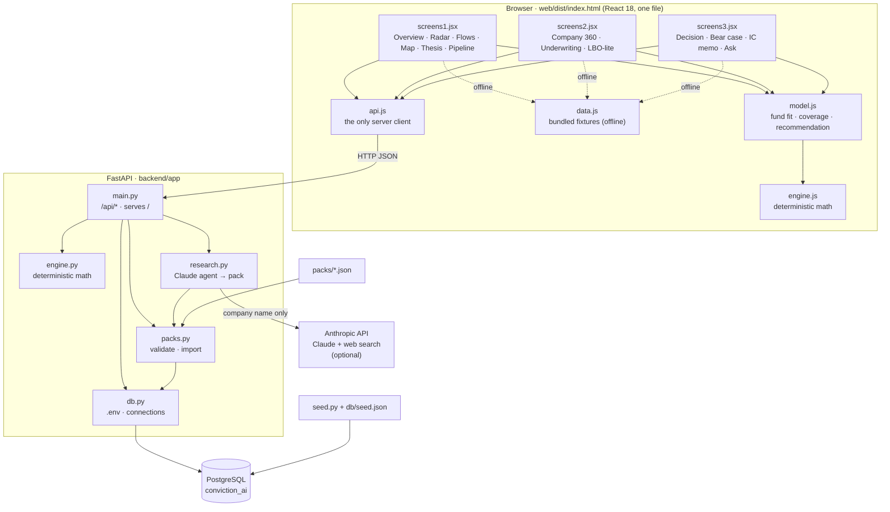
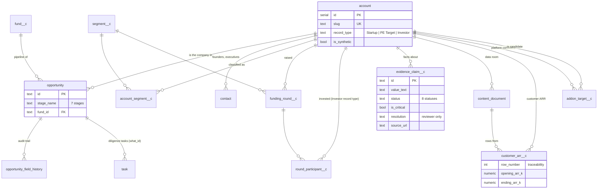
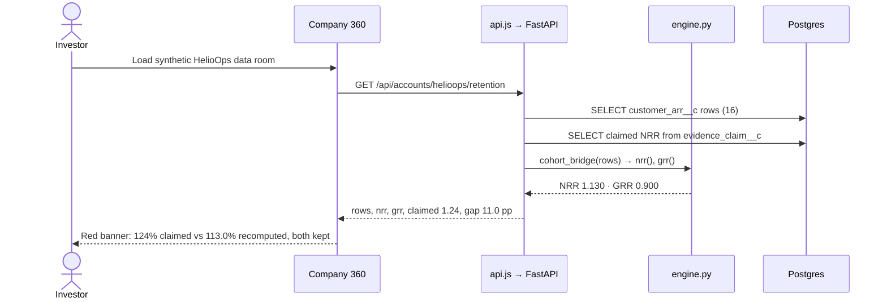
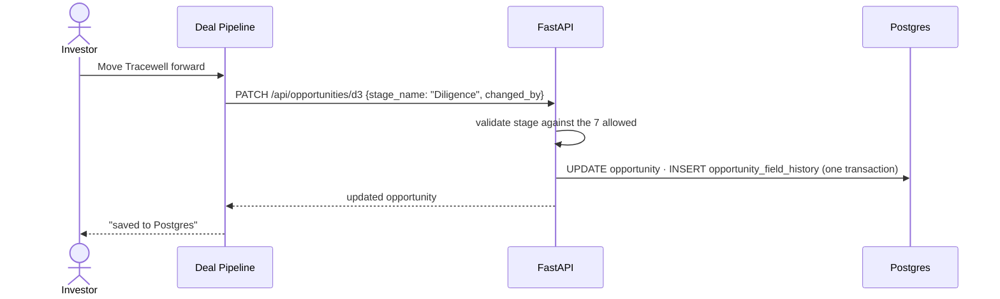
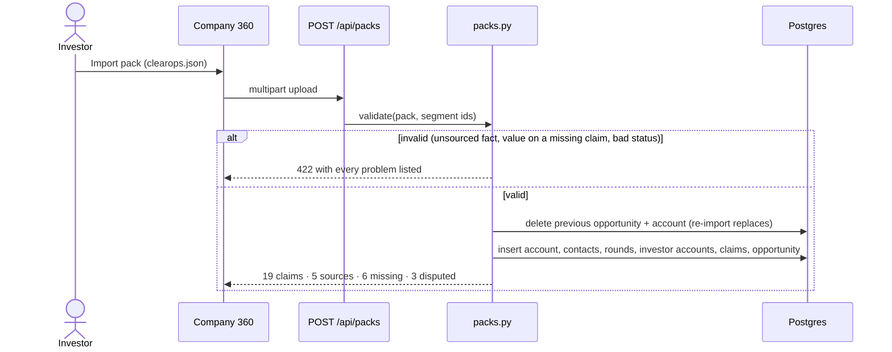
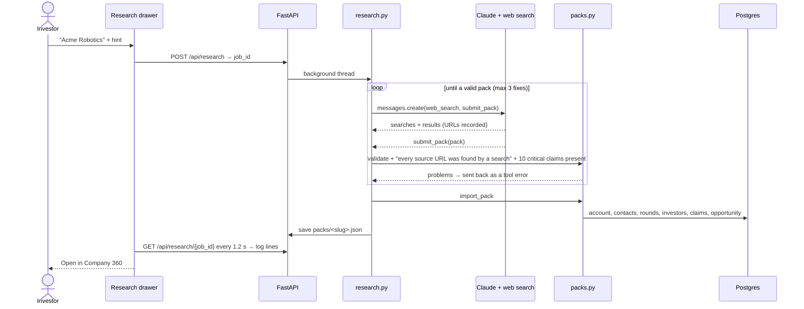

# Architecture

[← Back to README](../README.md)

Conviction AI is three layers and one rule. The layers are a PostgreSQL database shaped like Salesforce, a FastAPI service, and a React UI built into one HTML file. The rule: **numbers come from deterministic code, evidence is never overwritten, and people make the decisions.**

- [Components](#components)
- [Data model](#data-model)
- [The flows](#the-flows)
- [The engines](#the-engines)
- [Evidence and the recommendation](#evidence-and-the-recommendation)
- [Company packs](#company-packs)
- [Security model](#security-model)
- [Design decisions](#design-decisions)

## Components

| Component | Responsibility | Notes |
| --- | --- | --- |
| `web/src/*.jsx` | Screens | The design is fixed; screens only receive data in the shapes they already use |
| `web/src/api.js` | Server calls | Maps Salesforce-named API objects (e.g. `Opportunity.stage_name`) to screen shapes. If the page was opened as a file, every call throws `offline` and screens fall back to fixtures |
| `web/src/model.js` | Business rules | Fund-thesis fit, evidence coverage, blockers, recommendation category |
| `web/src/engine.js` / `backend/app/engine.py` | Math | Same formulas in both; both test suites lock in the same expected values |
| `web/build.mjs` | Build | esbuild bundles React and all code, inlines CSS, writes one `dist/index.html` (~270 KB) |
| `backend/app/main.py` | API | Endpoints named after the objects they serve; serves the UI at `/` |
| `backend/app/packs.py` | Company packs | Validates rules (sources, statuses, segments) and imports in one transaction |
| `backend/app/research.py` | Live research | Runs a Claude agent with web search until it submits a pack that passes validation; optional, needs `ANTHROPIC_API_KEY` |
| `backend/seed.py` | Seeding | Creates the database if missing, runs `schema.sql`, loads `seed.json`, imports every pack |
| `scripts/export-seed.mjs` | Single source of truth | Writes `db/seed.json` from the same fixtures the offline UI uses, so live and offline can't drift |

The rendered diagrams [architecture.svg](architecture.svg) and [request-flows.svg](request-flows.svg) show the same thing visually.

## Data model

Standard Salesforce objects keep their Salesforce names; objects a CRM doesn't have end in `__c`, as custom objects do in Salesforce. A firm on Salesforce could map each table to an object one to one.

Constraints worth knowing:

- `account.record_type` is one of `Startup`, `PE Target`, `Investor`; investors are accounts, as in Salesforce.
- `account_segment__c` has a partial unique index: **exactly one primary segment** per company, so a company in two segments is never double counted.
- `opportunity.stage_name` is checked against the seven stages, `Identified` → `Closed / Passed`.
- `evidence_claim__c.status` is checked against the eight statuses; `resolution` is only written by the resolve endpoint.
- `customer_arr__c.row_number` keeps the row in the source file so every recomputed figure points back to its rows.
- `schema.sql` starts with `DROP SCHEMA public CASCADE`, so `make db` always rebuilds cleanly.

## The flows

### Read: recompute NRR from source rows

### Write: move a deal and record who did it

### Import: a researched company

### Research: any company, live (optional)

Why it's built this way:

- **A tool call, not free text.** The agent returns the pack by calling `submit_pack`, whose input schema is the pack format, so the output is structured JSON rather than prose to parse.
- **The validator is the gate, not the prompt.** The prompt asks for honesty; the code enforces it. A URL the agent didn't get from a search is rejected, a value on a `missing` claim is rejected, an unsourced fact is rejected. Problems go back to the agent as a tool error so it can fix them.
- **No metrics from the model.** The agent may not use `verified` or `calculated`; NRR and the rest only ever come from customer rows through the engine.
- **Saved as a file.** The pack lands in `packs/`, so `make db` and **Reset demo** keep it, and it can be reviewed or committed like a hand-made pack. It's marked *not yet reviewed*.
- **Fictional companies are protected.** Research can't replace HelioOps or the other demo accounts.
- **Testable without a key.** `test_research.py` plays back scripted API responses.

### Offline

Opened as a file, `api.js` sees a `file:` URL and sets its base to `null`. Every call throws `offline`; each screen catches it and uses `data.js`. State is saved to `localStorage`. The same HTML file serves both modes.

## The engines

`backend/app/engine.py` and `web/src/engine.js` implement the same functions:

| Function | Formula |
| --- | --- |
| `cohort_bridge(rows)` | Opening ARR, expansion, contraction, churn and ending ARR for customers active at the start of the period. New logos are excluded by definition. |
| `nrr`, `grr` | NRR = ending ÷ opening. GRR = (opening − contraction − churn) ÷ opening. |
| `arr_growth`, `runway_months` | Growth = current ÷ prior − 1. Runway = cash ÷ monthly burn. |
| `tam`, `som` | TAM = buyers × annual spend. SOM = customers × ACV. |
| `vc_scenario`, `irr_single` | Exit value = exit ARR × multiple − net debt; proceeds = exit value × exit ownership; MOIC = proceeds ÷ investment; IRR = MOIC^(1/years) − 1. |
| `inflection_index` | Weighted sum: adoption 25%, technology 20%, funding 15%, white space 15%, catalysts 15%, talent 10%. |
| `adjusted_funding`, `rank_segments` | Re-scale the funding signal when the largest rounds are excluded, then re-rank. |

HelioOps's numbers, locked in by tests: opening cohort $3.0M, NRR **113.0%**, GRR **90.0%**, gap to the claim **+11.0 pp**. A test also documents that the $4.0M opening cohort in one section of the original requirements was a typo (it would give 109.75%).

## Evidence and the recommendation

Every fact is an `evidence_claim__c` with a status:

| Status | Meaning |
| --- | --- |
| Verified | Checked against a primary source |
| Calculated | Computed by the engine from source rows |
| Company-reported | The company says so; not independently checked |
| Third-party | Reported by press or a database |
| Inferred | Reasoned from other facts; phrased as something to verify |
| Assumption | An analyst input, such as a TAM assumption |
| Missing | Needed but not available. Never counts as a pass |
| Disputed | Sources disagree; both values kept until a reviewer resolves it |

**Coverage** = evidenced critical claims ÷ critical claims (10 per company). **Recommendation** (`model.js`), checked in order:

1. No data room, or coverage < 65% → **More diligence**
2. Any fund-thesis rule fails → **Pass / watch**
3. Any blocker (such as an unresolved disputed critical metric), or coverage < 85% → **Advance with conditions**
4. Otherwise → **Advance to IC**

The score and the coverage are shown separately so a high score can't hide thin evidence.

## Company packs

A pack turns web research into rows. `packs.py` enforces:

1. Every claim that isn't `missing` or `assumption` references a source id that exists in the pack.
2. A `missing` claim has no value.
3. Status is one of the eight above.
4. Exactly one primary segment, and it exists.

Re-importing a pack deletes the company's previous opportunity and account (cascading to its rows) and inserts it again, so imports are idempotent. Investor accounts are matched by name and reused. See [COMPANY_PACKS.md](COMPANY_PACKS.md).

## Value creation

Two sponsor screens reuse the evidence model. The **Add-on Screener** ranks `addon_target__c` rows for a platform account: `engine.rank_addons` takes the five 1–5 analyst scores and the user's weights (normalised) and returns a 0–100 score; unavailable candidates are listed unscored. **Exit Readiness** (`engine.exit_readiness`) maps 13 buyer-diligence items to claim-id patterns, takes the strongest matching claim's credit (verified 1.0 … missing 0) and weights it, so the score changes only when evidence does. Both functions exist in Python and JavaScript and are tested against the same expected numbers, so the offline file and the API agree. Candidates are `PE Target` accounts whose facts are evidence claims; they have no critical claims, so they stay out of the Company 360 picker.

## Security model

| Area | Approach |
| --- | --- |
| Network | Binds to `localhost:8000`. No authentication: a local demo, not a hosted service |
| Secrets | Only the Postgres password, in `.env`, ignored by git |
| SQL | Parameterised queries throughout (psycopg 3) |
| Uploads | CSV parsed as numbers with header validation (422 on bad input); packs parsed as JSON and validated before any write |
| External calls | None, unless `ANTHROPIC_API_KEY` is set; then research sends the company name and hint to the Anthropic API. No database content is sent |
| Data | Fictional, except ClearOps and its investors (public sources, linked) |

## Design decisions

| Decision | Why | Trade-off |
| --- | --- | --- |
| Salesforce-shaped schema | Investment teams often run on Salesforce; matching its objects makes a later sync a mapping, and speaks the language a RevOps or CRM team already knows | Some names (`what_id`, `__c`) look odd to people who don't know Salesforce |
| Postgres | Free, local, transactional; right for stage changes, resolutions and audit history | Large-scale market-signal analytics would suit a warehouse such as Snowflake later |
| One HTML file for the UI | The offline demo is one file anyone can open; live mode serves the same file, so the design can't drift between modes | Bigger single file (~270 KB) and no code-splitting |
| `api.js` as the only server client | Screens stay unchanged when the data source changes | A mapping layer to maintain |
| Deterministic engines in Python and JavaScript | The offline demo needs the math in the browser; the API needs it on the server; tests in both pin the same answers | Two implementations to keep in sync |
| No LLM in the calculation path | Reproducible numbers; no confident wrong figures | The *Ask* box is rule-based in this version |
| LLM for research, gated by code | Finding and organising public facts is what language models are good at; checking them is what code is good at | Each run costs searches and tokens and takes 1–3 minutes; results need a human review |
| Keep conflicting values | The disagreement is itself diligence evidence | More complex UI than "the latest value wins" |
| Missing never passes | Thin evidence must lower confidence, not hide | Researched companies look worse than their decks, which is the point |
| Seed generated from UI fixtures | One source of truth for demo data | `make db` needs Node as well as Python |

[← Back to README](../README.md)
