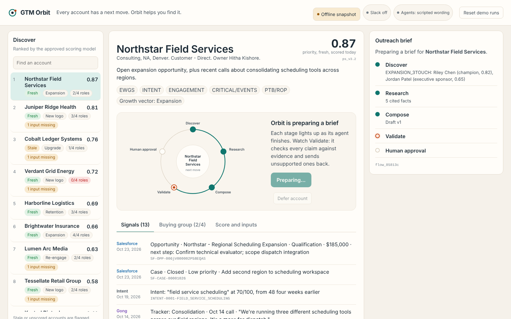
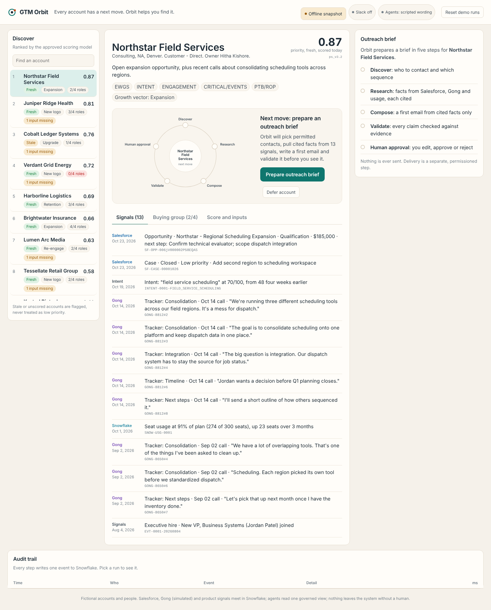
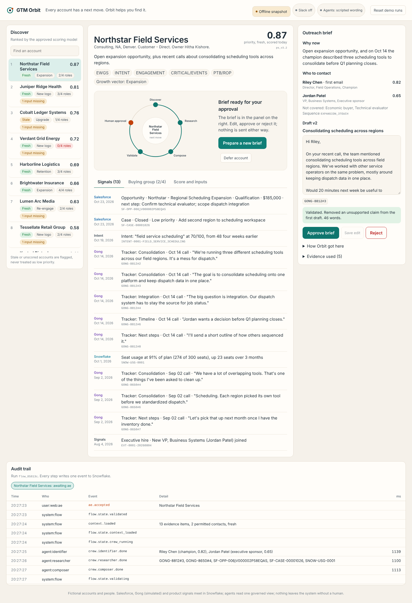
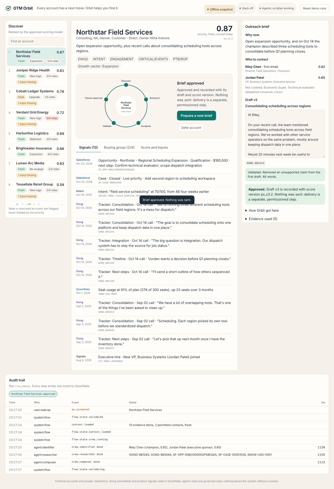
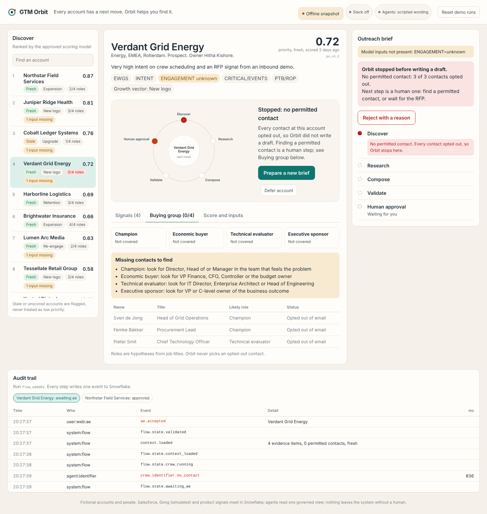
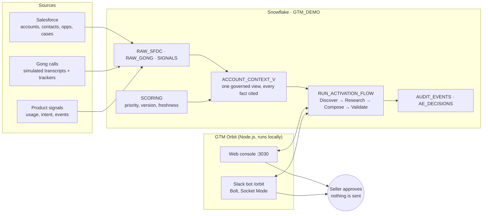

# GTM Orbit

**Every account has a next move. Orbit helps you find it.**

GTM Orbit is an account intelligence and AI workflow workspace for sellers. It turns a ranked account into a
seller-ready outreach brief. Salesforce, call data and product signals come together in Snowflake. Four bounded
agents build the brief from one governed view: **Discover → Research → Compose → Validate**. Every claim in the
brief cites its evidence, and the seller approves in a web console or in Slack. **Nothing is ever sent
automatically.**

It comes as two front ends on one engine:

- **Web console** (`http://localhost:3030`): queue, signals, buying group, brief, edit/approve, audit trail.
- **Slack bot** (`/orbit`): ask about an account, discover missing contacts, or get an outreach brief, all in Slack.



> All companies, people, calls and numbers in this project are fictional. Domains use the reserved `.example`
> top-level domain. This is a working demo and reference design, not a commercial product.

---

## Contents

1. [Why this exists](#why-this-exists)
2. [Try it in 2 minutes (no accounts needed)](#try-it-in-2-minutes-no-accounts-needed)
3. [Three ways to run it](#three-ways-to-run-it)
4. [Using the web console](#using-the-web-console)
5. [Using the Slack bot](#using-the-slack-bot)
6. [The 10 demo accounts](#the-10-demo-accounts)
7. [How it works](#how-it-works)
8. [Full setup: live Salesforce, Snowflake and Slack](#full-setup-live-salesforce-snowflake-and-slack)
9. [Configuration reference](#configuration-reference)
10. [HTTP API](#http-api)
11. [Testing](#testing)
12. [Project layout](#project-layout)
13. [Security and data handling](#security-and-data-handling)
14. [Troubleshooting](#troubleshooting)
15. [FAQ and limitations](#faq-and-limitations)
16. [License](#license)

---

## Why this exists

- Sellers spend about **40%** of their time selling, and **51%** of sales leaders using AI say disconnected
  systems slow it down ([Salesforce State of Sales 2026](https://www.salesforce.com/news/stories/state-of-sales-report-announcement-2026/)).
- **69%** of B2B buyers check AI-generated insights with a sales rep
  ([Gartner, May 2026](https://www.gartner.com/en/newsroom/press-releases/2026-05-20-gartner-survey-finds-sixty-nine-percent-of-b-two-b-buyers-turn-to-sales-reps-to-validate-ai-generated-insights)).
- By 2028 AI agents may outnumber sellers 10 to 1, yet fewer than **40%** of sellers are expected to say agents
  improved their productivity ([Gartner, Nov 2025](https://www.gartner.com/en/newsroom/press-releases/2025-11-18-gartner-predicts-by-2028-ai-agents-will-outnumber-sellers-by-10x-yet-fewer-than-40-percent-of-sellers-will-report-ai-agents-improved-productivity)).

A priority score tells a seller *which* account. It does not say *why now*, *who to contact* or *what to say*.
That context is scattered across systems, and AI drafts that invent facts erode trust. GTM Orbit's answer is
not more AI. It is context a seller can trust, delivered where they work, with the seller in control:

| Principle | What it means in GTM Orbit |
| --- | --- |
| **No uncited claims** | Every sentence in a draft must point to an evidence ID. The Validate agent rejects anything that doesn't, and sends it back at most twice before escalating to the seller. |
| **Unknown is not low** | A stale or missing score is shown as *stale* or *not scored*, never quietly ranked as low priority. |
| **Read, don't recompute** | The scoring model's score, version and freshness are read as-is. Agents never re-score accounts. |
| **Least privilege** | Agents read exactly one governed view. The app logs in as a key-pair service user that can read views and call procedures, nothing else. |
| **Human approval** | Only the account owner can approve. Approval records the decision; it does not send anything. |
| **Full audit trail** | Every agent step, validator catch and human decision is logged with timings. |

---

## Try it in 2 minutes (no accounts needed)

Offline mode replays a snapshot of the real data and agent runs. You need **Node.js 18.18 or newer**
([download](https://nodejs.org/)) and nothing else.

**1. Download.** GTM Orbit lives in the `GTM_Orbit` folder of this repository. Pick one:

```bash
# Option A: just this folder (smallest download)
git clone --filter=blob:none --sparse https://github.com/hithakishore-all/ai-product-leadership-portfolio.git
cd ai-product-leadership-portfolio
git sparse-checkout set GTM_Orbit

# Option B: the whole repository
git clone https://github.com/hithakishore-all/ai-product-leadership-portfolio.git
cd ai-product-leadership-portfolio
```

No git? On the repository page click **Code → Download ZIP**, unzip it, and open the `GTM_Orbit` folder.

**2. Install and run.**

```bash
cd GTM_Orbit/orbit
npm ci            # installs the exact tested versions (npm install also works)
npm run offline
```

**3. Open http://localhost:3030.** Pick **Northstar Field Services** and click **Prepare outreach brief**.
Watch Validate catch an unsupported claim and send it back, then edit the draft, approve it, and scroll to the
audit trail. Press `Ctrl + C` in the terminal to stop.

| | |
| --- | --- |
|  |  |
|  |  |

---

## Three ways to run it

| Mode | What you need | Command | Data | Slack |
| --- | --- | --- | --- | --- |
| **Offline** | Node.js | `npm run offline` | Snapshot in `orbit/mock/fixtures.json` | Off |
| **Offline + Slack** | Node.js, a Slack workspace where you can install apps | `npm run offline` with Slack tokens in `.env` | Snapshot | On |
| **Live** | Node.js, Snowflake account, optional Salesforce org and Slack | `npm start` | Your Snowflake `GTM_DEMO` database | On if tokens are set |

Offline mode behaves exactly like live mode on screen: same queue, same agent steps with realistic pacing, the
same validator catches, edits, approvals and audit trail. Runs are kept in memory and cleared when you restart.

In every mode the server prints what it is doing:

```
  GTM Orbit · offline snapshot
  Web console:  http://localhost:3030
  Slack bot:    off (add SLACK_BOT_TOKEN and SLACK_APP_TOKEN to .env to turn it on)
```

---

## Using the web console

The console is a three-column workspace.

1. **Queue (left).** Today's accounts ranked by the scoring model, each with its score, freshness chip
   (*fresh*, *stale*, *not scored*) and growth vector (Expansion, New logo, Upgrade, Retention, Re-engage).
2. **Account (middle).** The orbit diagram shows the five workflow stages. Three tabs:
   - **Signals**: every piece of evidence with its source (Salesforce, Gong, Intent, Product usage, Events),
     date and a quote or excerpt.
   - **Buying group**: who can be contacted, who can't and why (opted out, record incomplete), and which roles are
     missing with hints on who to look for.
   - **Score and inputs**: score, version, age, rationale and which model features were known or unknown.
3. **Brief (right).** Click **Prepare outreach brief**. The orbit lights up stage by stage as the agents run. When
   it finishes you get:
   - **Why now** and **Who to contact**, with confidence per buying role
   - The **draft email**, with each claim linked to its evidence ID
   - The validator result and number of retries
   - **Save edit**, **Approve brief** and **Reject with a reason**
4. **Audit trail (bottom).** Every event for the selected run: time, actor (agent, system or person), event,
   detail and duration. Recent runs appear as tabs.

Other controls: **Defer account** logs that the seller passed on the recommendation. **Reset demo runs** (top
right) clears run history so you can start a recording from a clean slate. The status chips in the header show
whether data is live or offline and whether Slack is connected.

---

## Using the Slack bot

Type these in any channel the bot can post in (see [Slack setup](docs/SETUP_SLACK.md)), or mention
**@GTM Orbit** with the same words, for example `@GTM Orbit brief Northstar`.

| Command | What it does |
| --- | --- |
| `/orbit` or `/orbit queue` | Today's ranked accounts with **Prepare brief**, **Contacts** and **Defer** buttons |
| `/orbit account <name>` | Account summary: score, freshness and version, growth vector, rationale, latest cited signals, buying-group coverage |
| `/orbit contacts <name>` | Discover missing contacts: permitted, blocked (and why) and missing roles |
| `/orbit brief <name>` | Runs Discover → Research → Compose → Validate, streaming progress into one message |
| `/orbit reset` | Clears demo runs |
| `/orbit help` | Lists the commands |

`<name>` can be the account key (`GTM-0001`) or any part of the name (`northstar`, `juniper`).

When a brief is ready, the bot posts it with **Approve**, **Edit draft** (opens a modal), **Reject** (asks for a
reason) and **View audit trail** (posts the trace in a thread).

**Who can approve.** Only the account owner can act on a brief. In this demo all accounts belong to one owner,
and the first Slack user who uses Orbit is mapped to that owner. Anyone else gets a private "only the account
owner can act" message.

---

## The 10 demo accounts

Each account is built to show one behavior. All are fictional.

| Key | Account | Score | What it demonstrates |
| --- | --- | --- | --- |
| GTM-0001 | Northstar Field Services | 0.87 | **The hero run.** Expansion opportunity plus an Oct 14 call about consolidating scheduling tools. The first draft claims "expanding into three new regions" from an unsourced note, Validate rejects it, and the rewrite is fully cited. One contact has opted out and is skipped. |
| GTM-0002 | Juniper Ridge Health | 0.81 | New logo with rising intent. A critical-events feature is *unknown*. The first draft congratulates them on a "Series C" nothing supports, and Validate catches it. |
| GTM-0003 | Cobalt Ledger Systems | 0.76 | **Stale** score (6 days old), unscored features, no calls in 90 days, incomplete contact data. Trap claim: "replacing your ERP next quarter". |
| GTM-0005 | Verdant Grid Energy | 0.72 | **When Orbit should stop.** Strong intent, but every contact opted out of email, so there is no permitted contact and no draft. |
| GTM-0004 | Harborline Logistics | 0.69 | Renewal at risk: escalated integration case, falling usage, a competitor named on the last call. |
| GTM-0009 | Brightwater Insurance | 0.66 | The clean run: proposal stage, 4 of 4 buying roles covered. |
| GTM-0008 | Lumen Arc Media | 0.63 | Closed-lost in April on budget; budget reopened on an Oct 20 call, so re-engage. |
| GTM-0006 | Tessellate Retail Group | 0.58 | Mid-priority new logo from a webinar; a competitor is mentioned. |
| GTM-0010 | Kestrel Biotech | 0.41 | Low priority, stale; no budget until 2027. |
| GTM-0007 | Quarry & Pine Manufacturing | — | **Not scored.** Shown as "not scored", never as low priority. |

The demo's "today" is pinned to **2026-10-23** (in `GTM_DEMO.APP.DEMO_CONFIG`) so recency windows and
freshness stay stable no matter when you run it.

---

## How it works



**The workflow, step by step**

| Stage | Agent | Reads | Produces | Guardrail |
| --- | --- | --- | --- | --- |
| 1. Discover | Identifier | Contact readiness in the governed view | Permitted contacts by buying role, missing roles, a sequence | Opted-out or incomplete contacts are never used. No permitted contact means stop, with no draft. |
| 2. Research | Researcher | Evidence in the governed view | Cited facts: why now, pains, risks | Only facts with an evidence ID. |
| 3. Compose | Composer | Research output | First email draft with a claim list | Each claim must reference evidence. |
| 4. Validate | Validator | Draft + evidence | Pass, or flagged claims back to Compose | At most 2 retries, then escalates to the seller. |
| 5. Human approval | The seller | Brief | Edit, approve or reject | Owner-only. Approval never sends. |

The flow is a Python stored procedure inside Snowflake (`GTM_DEMO.APP.RUN_ACTIVATION_FLOW`). It writes its state
to `FLOW_RUNS` and every step to `AUDIT_EVENTS`. The Node.js app starts runs, polls their progress, and calls
`AE_ACTION` for edits, approvals and rejections. Both front ends use the same engine (`orbit/lib/engine.js`).

**About the agents' wording.** Snowflake trial accounts block AI functions until a payment method is added, so
by default the agents return pre-written wording (`GTM_DEMO.APP.SCRIPTED_DRAFTS`). Everything around the wording
is real: the flow state machine, evidence checks, validator retries, owner check and audit trail. To use a
real model through Snowflake Cortex, see [Switching to a live model](docs/SETUP_SNOWFLAKE.md#switching-to-a-live-model).

More detail: [docs/ARCHITECTURE.md](docs/ARCHITECTURE.md) covers the data model, every view and procedure, the
flow states and the event catalog.

---

## Full setup: live Salesforce, Snowflake and Slack

Live mode runs against your own Snowflake database. Salesforce and Slack are optional. Budget about 30 minutes.

| Step | Guide | Required? |
| --- | --- | --- |
| 1. Load the 10 demo accounts into a Salesforce Developer org | [docs/SETUP_SALESFORCE.md](docs/SETUP_SALESFORCE.md) | Optional. Skip it and use the bundled sample records instead. |
| 2. Create the `GTM_DEMO` database, data, views, agents and service user | [docs/SETUP_SNOWFLAKE.md](docs/SETUP_SNOWFLAKE.md) | Required for live mode |
| 3. Create the Slack app and add its two tokens | [docs/SETUP_SLACK.md](docs/SETUP_SLACK.md) | Optional |
| 4. Run `npm start` in `orbit/` | Below | Required |

**Before you start**

- Node.js 18.18+ and npm
- A Snowflake account where you can use `ACCOUNTADMIN` (a [free trial](https://signup.snowflake.com/) works)
- `openssl` (built into macOS and most Linux; on Windows use Git Bash)
- Optional: Python 3.9+ (only to regenerate data), the Salesforce CLI, a Slack workspace where you can install apps

**Run it**

```bash
cd GTM_Orbit
cp .env.example .env        # then fill in SNOWFLAKE_ACCOUNT (and Slack tokens if you set up Slack)
cd orbit
npm ci
npm start
```

You should see `GTM Orbit · live Snowflake data`. If anything is missing, the server tells you exactly what and
which guide step fixes it, then exits. You can always fall back to `npm run offline`.

---

## Configuration reference

All settings live in `GTM_Orbit/.env` (copy `.env.example`). Never commit `.env`; it is git-ignored.

| Variable | Required | Default | Description |
| --- | --- | --- | --- |
| `SNOWFLAKE_ACCOUNT` | Live mode | — | Account identifier, e.g. `ABCDEFG-XY12345` (Snowsight → your name → Account → Copy account identifier) |
| `SNOWFLAKE_BOT_USER` | No | `GTM_SLACK_BOT` | Service user created by `snowflake/08_slack_bot.sql` |
| `SNOWFLAKE_PRIVATE_KEY_FILE` | No | `.keys/gtm_slack_bot.p8` | Path to the service user's private key, relative to `GTM_Orbit/` |
| `SLACK_BOT_TOKEN` | For Slack | — | Bot User OAuth Token, starts with `xoxb-` |
| `SLACK_APP_TOKEN` | For Slack | — | App-level token with `connections:write`, starts with `xapp-` |
| `ORBIT_PORT` | No | `3030` | Web console port |
| `ORBIT_HOST` | No | `127.0.0.1` | Interface to listen on. The console has no login, so keep it local. |
| `ORBIT_MOCK` | No | — | `1` forces offline mode (same as `npm run offline`) |

Settings inside Snowflake (`GTM_DEMO.APP.AGENT_CONFIG` and `DEMO_CONFIG`):

| Key | Default | Description |
| --- | --- | --- |
| `MODEL` | `scripted` | `scripted`, or a Cortex model name to generate wording with `AI_COMPLETE` |
| `MAX_RETRIES` | `2` | How many times Validate can send a draft back before escalating |
| `MAX_WORDS` | `130` | Validate rejects first-touch emails longer than this |
| `DEMO_MODE` | `true` | Composer sees unverified seller notes on its first draft, so Validate has something real to catch |
| `SENDER_NAME` / `SELLER` | `Alex` / `Acme` | Signature and seller company used in drafts |
| `SCRIPTED_DELAY_MS` | `1200` | Pause per scripted agent step so progress is watchable |
| `DEMO_CONFIG.AS_OF_DATE` | `2026-10-23` | The demo's "today" |
| `DEMO_CONFIG.STALE_AFTER_DAYS` | `3` | Scores older than this are flagged *stale* |
| `DEMO_CONFIG.GONG_LOOKBACK_DAYS` | `90` | Call evidence window |

---

## HTTP API

The web console uses a small JSON API that you can also call directly (for scripts or another front end).

| Method and path | Description |
| --- | --- |
| `GET /api/health` | `{ ok, data, slack, startedAt }`. 200 once ready. |
| `GET /api/status` | Data mode (`live`/`offline`), Slack state, agent mode |
| `GET /api/queue` | Ranked accounts |
| `GET /api/accounts/:key` | Full governed context for one account (404 if unknown) |
| `GET /api/accounts/:key/buying-group` | Permitted, blocked and missing roles |
| `POST /api/accounts/:key/defer` | Body `{ reason? }`. Logs a deferral. |
| `POST /api/runs` | Body `{ account }`. Starts a run and returns `{ jobId }`. One run per account at a time. |
| `GET /api/runs/:jobId` | `{ status: running/done/error, events[], flow }` |
| `GET /api/flows` | The 20 most recent runs |
| `GET /api/flows/:id` | One run, including its brief (`PACKAGE`) |
| `GET /api/flows/:id/trace` | Audit events for the run |
| `POST /api/flows/:id/actions` | Body `{ action: edit/approve/reject, text? }`. `text` is required for `edit`; the reject reason is optional. |
| `POST /api/reset` | Clears demo runs |

Errors return `{ error }` with 400 (bad input), 404 (unknown account, run or flow) or 500.

Example:

```bash
curl -s localhost:3030/api/queue | head -c 300
curl -s -X POST localhost:3030/api/runs -H 'content-type: application/json' -d '{"account":"GTM-0001"}'
```

---

## Testing

```bash
cd GTM_Orbit/orbit
npm test
```

The smoke test starts the real server in offline mode on a free port and walks the whole workflow through the
API: health, queue, buying group, a full brief where Validate rejects then passes, edit, approve, no double
approval, the no-permitted-contact stop, bad-input errors, and reset. It needs no accounts and takes about
10 seconds.

To check live mode, run `npm start`, open the console, and run Northstar. Then compare with Snowflake:

```sql
SELECT * FROM GTM_DEMO.APP.FLOW_TRACE_V ORDER BY TS DESC LIMIT 50;
```

---

## Project layout

```
GTM_Orbit/
├── README.md                 you are here
├── .env.example              settings template (copy to .env)
├── docs/
│   ├── ARCHITECTURE.md       data model, views, procedures, flow states, events
│   ├── SETUP_SALESFORCE.md   load the demo accounts into Salesforce (optional)
│   ├── SETUP_SNOWFLAKE.md    database, data, agents, service user, live model
│   ├── SETUP_SLACK.md        Slack app from manifest, tokens, first commands
│   ├── TROUBLESHOOTING.md    symptoms and fixes
│   └── screenshots/
├── orbit/                    the app (Node.js)
│   ├── server.js             web server, API, starts the Slack bot
│   ├── lib/engine.js         shared engine: account lookup, buying group, runs
│   ├── lib/snowflake-store.js  live data (key-pair login, role GTM_APP_RW)
│   ├── lib/mock-store.js     offline data (replays mock/fixtures.json)
│   ├── lib/slack.js          /orbit command, mentions, buttons, modals
│   ├── lib/slack-blocks.js   Slack message layouts
│   ├── public/               web console (HTML, CSS, JS; no build step)
│   ├── mock/fixtures.json    offline snapshot
│   ├── slack-manifest.yml    Slack app definition
│   └── test/smoke.test.js    end-to-end test
├── snowflake/                SQL, run in numeric order (see SETUP_SNOWFLAKE.md)
│   └── seed/                 the same seed data as CSV
├── salesforce/               import files for the 10 demo accounts
├── scripts/                  seeding, export and build helpers
└── data/generate_data.py     regenerates every seed file
```

---

## Security and data handling

- **Secrets stay local.** `.env` and `.keys/` are git-ignored. Slack tokens are read from `.env` only.
- **Service user, key pair only.** The app logs into Snowflake as `GTM_SLACK_BOT` (`TYPE = SERVICE`, no password)
  with a private key that never leaves your machine.
- **Least privilege.** The app's role `GTM_APP_RW` can read the contract views and call the flow procedures. It
  cannot read raw tables. Agents read only `ACCOUNT_CONTEXT_V`.
- **Local only by default.** The web console binds to `127.0.0.1` and has no login. Don't expose it to a network
  without putting authentication in front of it.
- **No outbound email.** Nothing in this project sends email or messages to contacts. Slack messages go only to
  the channel where you run `/orbit`.
- **Socket Mode.** The Slack bot opens an outbound WebSocket; you don't need a public URL or open ports.

See [SECURITY.md](SECURITY.md) to report a vulnerability.

---

## Troubleshooting

The most common issues are below. See [docs/TROUBLESHOOTING.md](docs/TROUBLESHOOTING.md) for the full list.

| Symptom | Fix |
| --- | --- |
| `Setup is not complete yet` on `npm start` | Follow the listed items, or run `npm run offline` |
| `Port 3030 is already in use` | Stop the other process, or set `ORBIT_PORT=3031` in `.env` |
| `JWT token is invalid` | The public key in Snowflake doesn't match `.keys/gtm_slack_bot.p8`. Redo step 5 of the Snowflake guide. |
| `/orbit failed because the app did not respond` | The server isn't running, or it started without Slack tokens. Check that the terminal shows `Slack bot: on`. |
| Slack buttons do nothing or post nothing | Use a public channel, or `/invite @GTM Orbit` to a private one. Check the terminal for errors. |
| Queue is empty in live mode | `05_salesforce_sample.sql` (or your own sync) wasn't run, so Salesforce tables are empty |

---

## FAQ and limitations

**Is the AI real?** The orchestration, evidence checks, validator retries, owner check and audit trail are real
code running in Snowflake. The agents' wording is scripted by default because trial accounts block AI functions.
One setting switches to a Cortex model.

**Is the data real?** No. Ten fictional accounts, people and calls built for the demo. The Gong data is simulated.

**Does it send email?** Never. Approval records the decision. Delivery would be a separate, permissioned step.

**Can I use my own accounts?** Yes, in principle: load your records into the `RAW_*` and `SIGNALS` tables, and
provide scores in `SCORING.PRIORITY_SCORES`. With `MODEL = scripted` only the 10 demo accounts have wording, so
use a live model for your own data.

**What would production need?** A real Gong (or other call) connector, the scoring model owner's feed,
a live model for agent wording, SSO and per-user identity in Slack, hosting with authentication for the web
console, and a pilot in shadow mode first.

**Known limitations**

- Owner mapping is simplified: the first Slack user to use Orbit becomes the owner of all demo accounts.
- Offline runs are kept in memory and cleared on restart.
- Live mode polls Snowflake for progress about once a second while a run is active.
- The web console has no authentication and is meant for local use.

---

## License

[MIT](LICENSE). Fictional data included. Third-party names are used only to describe integrations.
