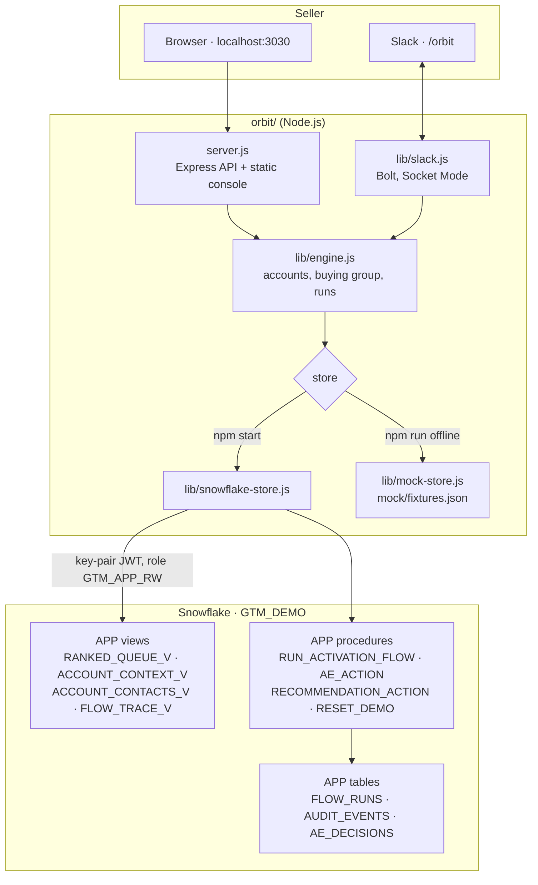
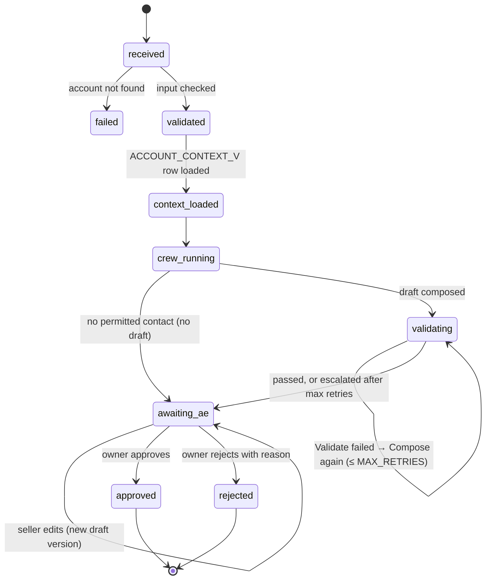

# Architecture

GTM Orbit is three layers:

- **Sources.** Salesforce, call data and product signals.
- **Snowflake.** It holds the data, the scoring output, one governed view and the agent flow.
- **A small Node.js app.** It serves a web console and a Slack bot from one engine.

The design goal is a brief the seller can trust. Every claim is cited, unknowns are visible, the seller approves,
and every step is logged.

[← Back to README](../README.md)

## Components



| Component | Responsibility |
| --- | --- |
| `server.js` | Loads `.env`, checks configuration, serves `public/`, exposes the JSON API, starts the Slack bot when both tokens are set, and shuts down cleanly on Ctrl + C |
| `lib/engine.js` | Picks the store (live or offline), resolves account names, builds the buying group (permitted, blocked, missing roles), starts runs (one per account at a time) and reports progress |
| `lib/snowflake-store.js` | Opens three connections (main, progress poller, flow worker) as `GTM_SLACK_BOT`, reads views and calls procedures. All SQL uses bind variables |
| `lib/mock-store.js` | The same interface over `mock/fixtures.json`. It replays pre-computed runs with realistic pacing and keeps runs and audit events in memory |
| `lib/slack.js` | Handles `/orbit`, `@GTM Orbit` mentions, buttons and modals, streams progress into one message, and checks ownership |
| `lib/slack-blocks.js` | Slack Block Kit layouts |
| `public/` | The web console: plain HTML, CSS and JavaScript with no build step. It polls the API while a run is active |

## Data model

Six schemas, each with one job.

| Schema | Contents | Who writes it |
| --- | --- | --- |
| `RAW_SFDC` | `ACCOUNT`, `CONTACT`, `OPPORTUNITY`, `CASES`: a mirror of Salesforce keyed by 18-character IDs | Salesforce sync (`05_*.sql`) |
| `RAW_GONG` | `CALLS`, `CALL_PARTICIPANTS`, `TRANSCRIPT_UTTERANCES`, `TRACKER_HITS` (simulated) | Seed |
| `SIGNALS` | `PRODUCT_USAGE_MONTHLY`, `INTENT_SIGNALS_WEEKLY`, `CRITICAL_EVENTS` | Seed |
| `SCORING` | `PRIORITY_SCORES` (score, version, scored at, rationale, feature status), `GROWTH_VECTOR` | The scoring model. Agents never write or recompute it. |
| `INSIGHTS` | Reserved for conversational insights (phase 2) | — |
| `APP` | Config, contract views, flow state, audit trail | The flow procedures |

### The governed view: `APP.ACCOUNT_CONTEXT_V`

Agents read exactly this one view. One row per account:

| Column group | Columns |
| --- | --- |
| Identity | `SALESFORCE_ACCOUNT_ID`, `ACCOUNT_KEY`, `ACCOUNT_NAME`, `INDUSTRY`, `ACCOUNT_TYPE`, `REGION`, `BILLING_CITY`, `BILLING_COUNTRY`, `EMPLOYEES`, `ANNUAL_REVENUE` |
| Ownership | `OWNER_ID`, `OWNER_NAME`, `OWNER_EMAIL` |
| Score (read-only) | `PRIORITY_SCORE`, `SCORE_VERSION`, `SCORED_AT`, `SCORE_RATIONALE`, `FEATURE_STATUS` (known/unknown per input), `SCORE_AGE_DAYS`, `SCORE_FRESHNESS` (`fresh`, `stale`, `unscored`) |
| Play | `GROWTH_VECTOR`, `ALLOWED_SEQUENCES` |
| Contacts | `CONTACT_READINESS`: roles covered of 4, missing roles, permitted contacts with role hypothesis, opted-out count |
| Evidence | `EVIDENCE`: an array of `{ ref_id, source, ts, excerpt, url }` built by `EVIDENCE_V` |

Evidence IDs follow a fixed pattern, so each claim can be traced to a source record (`<nnnn>` is the account number without `GTM-`):

| Pattern | Source |
| --- | --- |
| `SF-OPP-<id>` | Salesforce opportunity (open, or closed in the last 365 days) |
| `SF-CASE-<number>` | Salesforce case |
| `<call>#<utterance>`, e.g. `GONG-8812#3` | A specific line of a call transcript with a tracker hit (last 90 days) |
| `GONG-none` | An explicit "no calls in the lookback window" marker |
| `INTENT-<nnnn>-<TOPIC>` | Weekly intent topic and its four-week trend |
| `SNOW-USG-<nnnn>` | Product seat usage and its three-month trend |
| `EVT-<nnnn>-<yyyymmdd>` | A critical event (funding, leadership change, and so on) |

Other views:

- `RANKED_QUEUE_V`: the queue in score order, with freshness, growth vector and missing roles.
- `CONTACT_READINESS_V`: buying-role coverage per account.
- `ACCOUNT_CONTACTS_V`: every contact with permitted, opted-out and incomplete flags.
- `FLOW_TRACE_V`: audit events joined to account names.

### Flow state and audit tables

| Table | Purpose |
| --- | --- |
| `FLOW_RUNS` | One row per run: `STATE`, `RETRIES`, `DRAFT_VERSION`, `CURRENT_DRAFT`, `PACKAGE` (the brief as JSON) |
| `AUDIT_EVENTS` | Append-only. Event, actor, duration, detail (JSON), account, score version |
| `AE_DECISIONS` | Accepted, deferred, edited, approved and rejected, with draft and score version |
| `PROCESSED_ACTIONS` | Idempotency keys, so a double-clicked Slack button counts once |
| `AE_DIRECTORY` | Salesforce owner mapped to a Slack user |
| `AGENT_CONFIG`, `DEMO_CONFIG` | Settings (see the configuration reference in the README) |
| `SCRIPTED_DRAFTS`, `AE_NOTES` | Scripted wording, and unverified seller notes. The notes are deliberately not evidence; they exist to show Validate catching an uncited claim. |

## The flow

`CALL GTM_DEMO.APP.RUN_ACTIVATION_FLOW(account, user)` runs synchronously inside Snowflake as a Python
(Snowpark) procedure. The app calls it on a dedicated connection and polls `FLOW_TRACE_V` on another, which is how
progress appears live.



### Agents

| Agent | Input | Output | Rules |
| --- | --- | --- | --- |
| **Identifier** (Discover) | Permitted contacts, missing roles, allowed sequences | Contacts with role and confidence, a primary contact, a sequence | Never uses opted-out or incomplete contacts. Emits `crew.identifier.no_contact` and stops if none are permitted. |
| **Researcher** (Research) | Evidence array | Research summary and cited facts | Each fact carries a `ref_id` from the evidence |
| **Composer** (Compose) | Facts, contact, flagged claims from previous attempts | Subject, body, and a claim list mapping each claim to a `ref_id` | On retries, must drop or fix flagged claims |
| **Validator** (Validate) | Draft, claims, evidence | Pass/fail, flagged claims, reasons, word count | Every claim needs a real `ref_id`. Unsupported statements and over-length drafts fail. |

With `MODEL = 'scripted'`, the agents' wording comes from `SCRIPTED_DRAFTS`. The evidence lookups, Validator
checks, retries, states and logging are the same code paths used with a live model. With a model name, the same
procedure calls `AI_COMPLETE` and asks for JSON.

### The brief (`FLOW_RUNS.PACKAGE`)

```json
{
  "flow_id": "flow_062257",
  "status": "ready_for_review",
  "account": { "key": "GTM-0001", "name": "Northstar Field Services", "owner": "Alex Rivera" },
  "score": { "priority_score": 0.87, "version": "ps_v3.2", "freshness": "fresh", "rationale": "..." },
  "growth_vector": "Expansion",
  "sequence": "EXPANSION_3TOUCH",
  "contact_readiness": { "roles_covered": 2, "roles_total": 4, "missing_roles": ["economic_buyer", "technical_evaluator"] },
  "contacts": [{ "name": "Riley Chen", "role": "champion", "confidence": 0.82, "why": "..." }],
  "research_summary": "...",
  "facts": [{ "ref_id": "GONG-8812#3", "fact": "..." }],
  "draft": { "subject": "...", "body": "..." },
  "claims": [{ "claim": "...", "ref_id": "GONG-8812#3" }],
  "validator": { "passed": true, "flagged_claims": [], "reasons": [], "word_count": 46 },
  "retries": 1,
  "warnings": []
}
```

### Event catalog

| Event | Actor | Meaning |
| --- | --- | --- |
| `ae.accepted` | `user:<id>` | Seller asked for a brief |
| `flow.state.<state>` | `system:flow` | State change (see diagram) |
| `context.loaded` | `system:flow` | Governed context read, with evidence count |
| `crew.identifier.done` / `.no_contact` | `agent:identifier` | Contacts chosen, or none permitted |
| `crew.researcher.done` | `agent:researcher` | Facts gathered |
| `crew.composer.done` | `agent:composer` | Draft written (once per attempt) |
| `crew.validator.failed` / `.passed` / `.escalated` | `agent:validator` | Validation result |
| `ae.edited` / `ae.approved` / `ae.rejected` | `user:<id>` | Human decision |
| `ae.recommendation.deferred` | `user:<id>` | Seller deferred the account |
| `flow.failed` | `system:flow` | Run could not start (for example, unknown account) |

## Security model

| Control | Implementation |
| --- | --- |
| Identity | `GTM_SLACK_BOT` is `TYPE = SERVICE` with RSA key-pair (JWT) login only. The private key stays on the machine running Orbit. |
| Least privilege | `GTM_APP_RW` has `SELECT` on the contract views and `USAGE` on the flow procedures. It can insert into the flow and audit tables but has no access to `RAW_*`, `SIGNALS` or `SCORING`. The procedures run `EXECUTE AS OWNER`. `GTM_AGENT_RO` is limited to `ACCOUNT_CONTEXT_V`. |
| Owner check | `AE_ACTION` only accepts edits, approvals and rejections from the mapped owner. The Slack bot also checks before starting a run. |
| Idempotency | Every action carries an idempotency key stored in `PROCESSED_ACTIONS`. |
| No delivery | No code path sends email. Approval is a recorded decision. |
| Injection safety | All SQL from the app uses bind variables. Slack text is escaped before rendering. |
| Local surface | The web console binds to `127.0.0.1` and has no login. Slack uses Socket Mode, so nothing listens publicly. |

## Design decisions

- **The flow runs inside Snowflake**, not in the app. Data never leaves the warehouse for agent work, every step
  is logged next to the data, and the app stays a thin client.
- **One governed view** instead of letting agents query tables. It is easy to review, easy to grant, and every fact
  arrives with its source and date.
- **Scripted wording on trial accounts** keeps the demo honest and repeatable. The guardrails don't depend on the
  model, so swapping in a live model changes the wording, not the controls.
- **Offline snapshot from the deployed code.** `scripts/build_orbit_fixtures.py` runs the same agent functions
  as the Snowflake procedure, so offline and live runs behave the same.
- **Pinned "today".** `DEMO_CONFIG.AS_OF_DATE` keeps freshness and recency windows stable for recordings.
