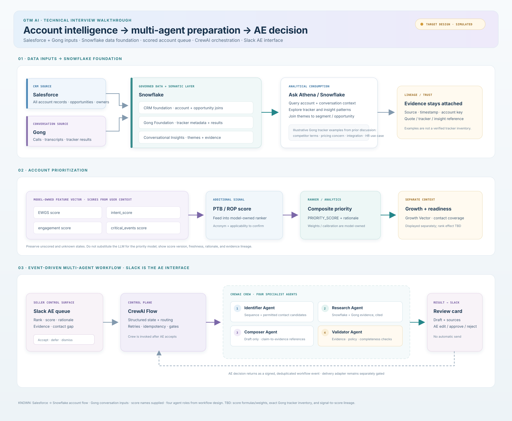

# Technical architecture: GTM Agent Studio

## System flow

1. **Salesforce** supplies all account records and related CRM context.
2. **Gong** supplies conversation data and tracker outputs. Your earlier Gong discussion described keyword trackers for named terms (such as competitor or partner mentions) and AI trackers phrased as natural-language detections (such as pricing concerns, integration interest, or HR use cases). Those are illustrative examples, not a confirmed inventory of currently configured trackers.
3. **Snowflake** joins the CRM account/opportunity foundation with Gong Foundation tracker data and Conversational Insights. Ask Athena is the analyst-facing query path over these governed models.
4. **Account scoring** consumes the model-owned EWGS, intent, engagement, critical-events, and PTB/ROP score inputs and produces `PRIORITY_SCORE` with a rationale. We do not calculate these scores in the LLM layer.
5. **Slack** presents the ranked account queue. AE acceptance starts the preparation workflow.
6. **CrewAI Flow** owns workflow state, routing, retries, deduplication, and approval gating. It invokes a **CrewAI Crew** for bounded work by four specialist agents.
7. The reviewed package returns to **Slack** for AE edit/approve/reject. The demo has no send integration.

## Data layers

- **Gong native tracker signals:** keyword matches and AI tracker detections in call records.
- **Gong Foundation:** governed call facts, tracker definitions/results, metadata, and CRM joins in Snowflake.
- **Conversational Insights:** structured themes/intent/use cases and source evidence such as quotes, as described in the prior discussion.
- **Account score layer:** ranking and rationale owned by the approved scoring model.
- **GTM workflow:** uses score and evidence for explainable seller preparation; it does not infer or alter the score.

## CrewAI agent contracts

| Agent | Responsibility | Output boundary |
|---|---|---|
| Identifier | Selects sequence and candidate contacts from supplied permitted records | Candidate list, source, role hypothesis, gaps; no invented identities |
| Researcher | Summarizes approved Snowflake/Gong account evidence | Evidence-linked facts with freshness and uncertainty |
| Composer | Drafts a message using only supplied evidence | Draft only; no sending or unsupported claims |
| Validator | Checks evidence references, policy conditions, and completeness | Pass/findings for AE review; never approves on AE's behalf |

## Data and execution guardrails

- Keep priority score, Growth Vector/context, and contact readiness separate.
- Preserve missing/unknown/unscored states; they are not negative values.
- Carry source IDs, timestamps, score/model version, and evidence references into the Slack card.
- Enforce access, suppression, opt-out, and ownership rules in deterministic integration code.
- Use event IDs and account IDs for Slack-event deduplication in a production adapter.
- Keep external writes in separately permissioned adapters, behind explicit AE approval.

## Scoring details still to confirm

The project materials show `PRIORITY_SCORE` and rationale but not the EWGS/intent/engagement/critical-events/PTB-or-ROP definitions, scales, coefficients, normalization, thresholds, or source lineage. The diagram marks those as model-owned and to be confirmed; no weights are inferred.

## Reference implementation

- `demo/index.html` is a local UI simulation with synthetic records and simulated agent progress.
- `src/gtm_agent_studio/flow.py` is an optional CrewAI reference starter that uses a live configured model on synthetic input. It has no Salesforce, Snowflake, Gong, or Slack adapter.
- Production integrations and real score computation are intentionally outside this interview starter.
